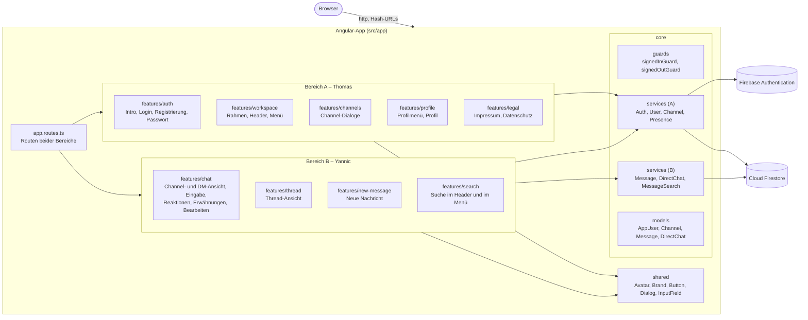
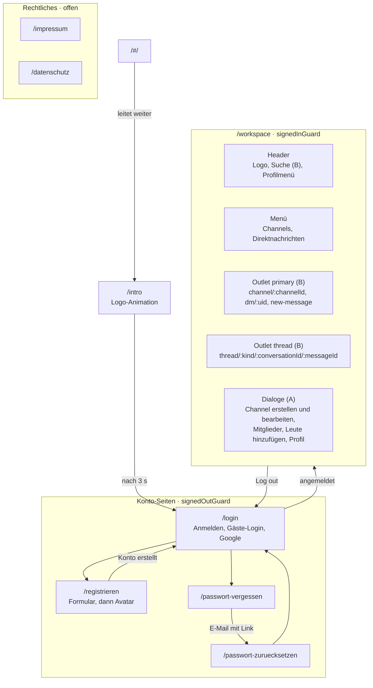
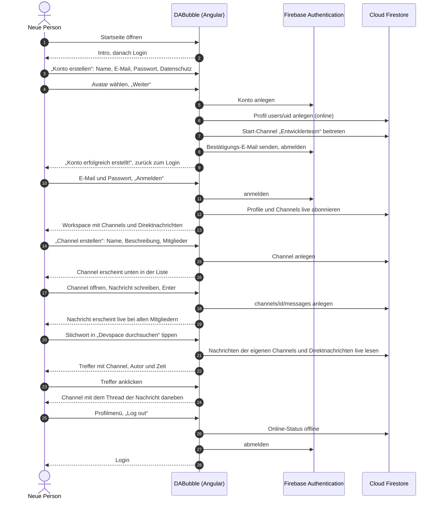
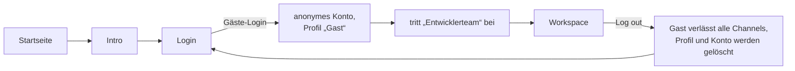
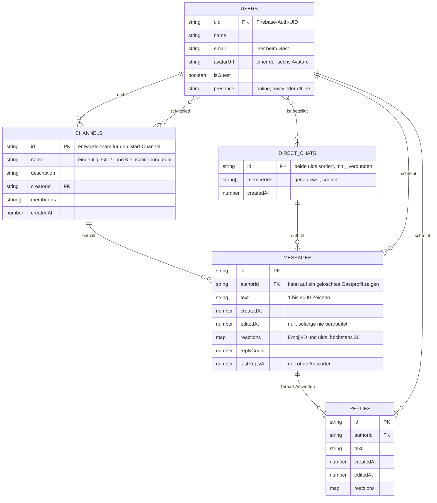
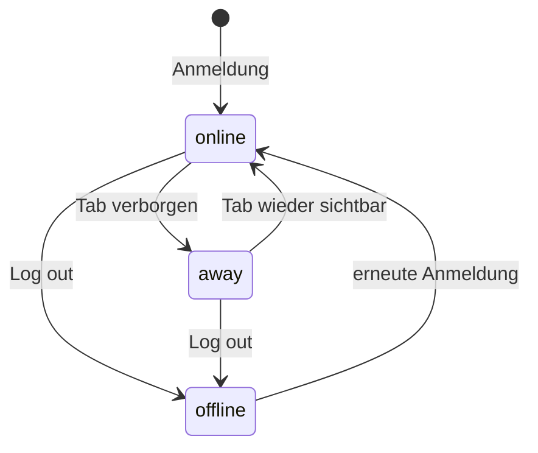
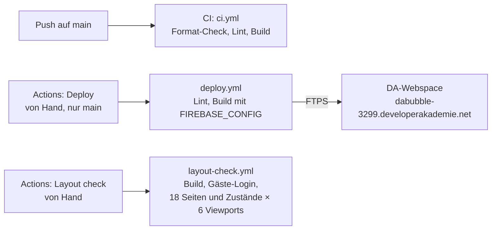

# DABubble

Team-Messenger im Stil von Slack: Channels, Direktnachrichten, Threads und Reaktionen in einem Workspace.
Gruppenprojekt der Developer Akademie, umgesetzt mit Angular 22 und Firebase.

[](https://github.com/ttoebbe/dabubble/actions/workflows/ci.yml)

**Live:** <https://dabubble-3299.developerakademie.net> – zum Ausprobieren „Gäste-Login“ wählen.

> **Stand 24.10.2026:** Bereich A (Konto, Workspace-Rahmen, Channels) ist fertig. Bereich B (Nachrichten,
> Threads, Suche) steht auf `main`: Channel- und Direktnachrichten, Reaktionen, Emojis, Threads, Erwähnungen,
> Bearbeiten, „Neue Nachricht“ und die Suche. Live ist der Stand vom 24.10.2026 (`040e841`). Offene Punkte: [`docs/todo.md`](docs/todo.md).

## Inhalt

- [Funktionen](#funktionen)
- [Tech-Stack](#tech-stack)
- [Architektur](#architektur)
- [Routen und Ansichten](#routen-und-ansichten)
- [Happy Flow](#happy-flow)
- [Datenmodell](#datenmodell)
- [Online-Status](#online-status)
- [Ordnerstruktur](#ordnerstruktur)
- [Schnittstellen zwischen den Bereichen](#schnittstellen-zwischen-den-bereichen)
- [Projekt starten](#projekt-starten)
- [Qualität](#qualität)
- [CI, Deploy und Layout-Check](#ci-deploy-und-layout-check)
- [Team und Zusammenarbeit](#team-und-zusammenarbeit)
- [Dokumentation](#dokumentation)

## Funktionen

Grundlage ist die Checkliste der Developer Akademie (`docs/DA_Checkliste/`), das Design kommt aus Figma
(`docs/Figma/spec.md`).

### Konto und Workspace (Bereich A)

| Funktion                                                                            | Checkliste        | Stand                                |
| ----------------------------------------------------------------------------------- | ----------------- | ------------------------------------ |
| Registrierung mit Name, E-Mail, Passwort, Datenschutz-Häkchen und Avatar-Auswahl    | Konto US1         | fertig                               |
| Anmeldung mit Google                                                                | Konto US1 (opt.)  | fertig                               |
| Bestätigungs-E-Mail nach der Registrierung                                          | Konto US1 (opt.)  | fertig                               |
| Login mit E-Mail und Passwort, Fehlermeldung direkt am Feld                         | Konto US2         | fertig                               |
| Gäste-Login; der Gast wird beim Log out samt Profil gelöscht                        | Figma             | fertig                               |
| Passwort vergessen: E-Mail mit Link, neues Passwort setzen                          | Konto US3         | fertig                               |
| Profil ansehen und bearbeiten (Name, Avatar aus der Auswahl)                        | Konto US4         | fertig                               |
| Menü mit Channels und Direktnachrichten ein- und ausklappen                         | Konto US5         | fertig                               |
| Mobile Ansichten: Menü → Chat → Thread mit Zurück-Pfeil                             | Konto US5         | fertig                               |
| Online-Status (aktiv, abwesend, offline) im Menü, im Profil und in Mitgliederlisten | Konto US6 (opt.)  | fertig, auch in Chats und Threads    |
| Channel erstellen mit Name, Beschreibung und Mitgliedern, Namensprüfung             | Channels US1      | fertig                               |
| Mitglieder nachträglich hinzufügen                                                  | Channels US2      | fertig                               |
| Channel verlassen                                                                   | Channels US3      | fertig                               |
| Name und Beschreibung bearbeiten, Fehlermeldung bei gescheitertem Speichern         | Channels US4      | fertig                               |
| Start-Channel „Entwicklerteam“: jedes neue Konto und jeder Gast tritt bei           | Entscheidung Team | fertig                               |
| Intro mit Logo-Animation, Impressum, Datenschutz                                    | Figma             | fertig (Impressum-Daten fehlen noch) |

### Nachrichten (Bereich B)

| Funktion                                                                         | Checkliste    | Stand                         |
| -------------------------------------------------------------------------------- | ------------- | ----------------------------- |
| Nachrichten im Channel senden und empfangen, live                                | Channels US1  | fertig                        |
| Direktnachrichten, auch mit sich selbst; Fokus beim Chatwechsel im Eingabefeld   | Schreiben US1 | fertig                        |
| Reaktionen: zwei zuletzt genutzte Emojis, „+ x weitere“, wer reagiert hat        | Schreiben US2 | fertig                        |
| Emojis in Nachrichten, Zähler bei mehrfach genutzten Reaktionen                  | Schreiben US3 | fertig                        |
| „Neue Nachricht“: `#` listet Channels, `@` Personen, sonst Name oder E-Mail      | Schreiben US4 | fertig                        |
| Threads in Channels und Direktnachrichten, „2 Antworten“, „Letzte Antwort 14:56“ | Schreiben US5 | fertig                        |
| `@` und `#` im Eingabefeld, Erwähnungen im Text klickbar                         | Schreiben US5 | fertig                        |
| Suche: `#` Channels, `@` Personen, sonst auch Nachrichten mit Kontext, live      | Schreiben US6 | fertig, auch Thread-Antworten |
| Eigene Nachrichten und Antworten bearbeiten                                      | Figma         | fertig                        |

## Tech-Stack

| Bereich         | Technik                                                                                      |
| --------------- | -------------------------------------------------------------------------------------------- |
| Framework       | Angular 22: Standalone Components, Signals, zoneless, Control Flow (`@if`, `@for`)           |
| Formulare       | Signal Forms (`@angular/forms/signals`) mit eigener Validierung, keine HTML5-Meldungen       |
| Sprache         | TypeScript im Strict Mode                                                                    |
| Styles          | SCSS nach BEM, Design-Tokens als CSS Custom Properties (`src/styles/`)                       |
| Backend         | Firebase Authentication (E-Mail/Passwort, Google, anonym) und Cloud Firestore (europe-west3) |
| Routing         | Angular Router mit Hash-URLs (`/#/login`), weil der Webspace `.htaccess` nicht auswertet     |
| Code-Qualität   | ESLint (angular-eslint, Zeilenlimits, Barrierefreiheit), Prettier                            |
| Automatisierung | GitHub Actions: CI bei jedem Push, Deploy und Layout-Check von Hand                          |
| Hosting         | Webspace der Developer Akademie, Upload per FTPS                                             |

## Architektur

Die App spricht direkt mit Firebase, ein eigenes Backend gibt es nicht. Firestore-Zugriffe liegen nur in den
Services unter `core/services/`; die Komponenten lesen deren Signals.



## Routen und Ansichten

Die Routen stehen hinter `#`, z. B. `https://dabubble-3299.developerakademie.net/#/login`. Bereich A
definiert seine Routen in `auth.routes.ts`, `legal.routes.ts` und `workspace.routes.ts`, Bereich B in
`chat.routes.ts`, die als Kinder unter `/workspace` hängen. Die Konto-Seiten öffnen nur abgemeldet
(`signedOutGuard`), der Workspace nur angemeldet (`signedInGuard`), Impressum und Datenschutz immer.



Breakpoints (`src/styles/_breakpoints.scss`): ab 1440 px stehen Menü, Chat und Thread nebeneinander, ab 768 px
höchstens zwei Bereiche, darunter immer nur einer (Menü → Chat → Thread). Alle Seiten funktionieren bis 320 px
ohne horizontale Scrollleiste.

## Happy Flow

Eine neue Person registriert sich, meldet sich an, legt einen Channel an, schreibt eine Nachricht, findet sie
über die Suche wieder und meldet sich ab.



Der kürzeste Weg für Prüfer ist der Gäste-Login:



## Datenmodell

Umgesetzt nach ttoebbe/dabubble#1. Nachrichten liegen als Untercollection am Channel bzw. an der
Direktnachricht (`channels/{id}/messages`, `directChats/{id}/messages`), Thread-Antworten an der Nachricht
(`…/messages/{id}/replies`). Eine Direktnachricht entsteht mit der ersten Nachricht.



Die Firestore-Regeln stehen in [`firestore.rules`](firestore.rules) und sind in der Firebase-Konsole
veröffentlicht. Kurz: Angemeldete lesen alle Profile und Channels, jede Person schreibt nur ihr eigenes Profil,
Channels ändern nur Mitglieder, und dem Start-Channel darf man sich selbst hinzufügen. Nachrichten und Antworten
lesen und schreiben nur die Mitglieder des Channels bzw. der Direktnachricht; den Text ändert nur der Autor,
reagieren dürfen alle Mitglieder (höchstens 20 Emojis je Nachricht).

## Online-Status



Der Punkt am Avatar ist grün für „Aktiv“ und grau für „Abwesend“ oder offline (`PresenceService`).

## Ordnerstruktur

```text
src/
├── app/
│   ├── app.config.ts            Router (Hash-URLs), globale Fehler-Listener
│   ├── app.routes.ts            bindet die Routen beider Bereiche ein
│   ├── core/
│   │   ├── guards/              signedInGuard, signedOutGuard
│   │   ├── models/              AppUser, Channel, Message, DirectChat
│   │   └── services/            A: firebase, auth, user, channel, channel-membership, presence
│   │                            B: message, direct-chat, message-search
│   ├── features/
│   │   ├── auth/                Intro, Login, Registrierung, Avatar, Passwort vergessen und zurücksetzen
│   │   ├── workspace/           Rahmen, Header, Menü, Menü-Umschalter
│   │   ├── channels/            Channel erstellen und bearbeiten, Mitglieder, Leute hinzufügen
│   │   ├── profile/             Profilmenü, Profil-Dialog, Profil bearbeiten, ProfileViewer
│   │   ├── legal/               Impressum, Datenschutz
│   │   ├── chat/                B: Channel- und DM-Ansicht, Eingabe, Reaktionen, Erwähnungen, Bearbeiten
│   │   ├── thread/              B: Thread-Ansicht
│   │   ├── new-message/         B: „Neue Nachricht“
│   │   └── search/              B: Suche im Header (Desktop) und im Menü (mobil)
│   └── shared/
│       ├── components/          avatar, brand, button, dialog, input-field
│       └── pipes/               gemeinsame Pipes (geplant)
├── environments/                environment.example.ts im Repo, environment.ts nur lokal
└── styles/                      _tokens, _base, _forms, _breakpoints
public/                          img/ (Avatare, Emojis, Icons, Logos), fonts/, .htaccess
docs/                            Checkliste, Figma-Spec, Arbeitsteilung, Einstieg, ToDo
.github/workflows/               ci.yml, deploy.yml, layout-check.yml
tools/layout-check/              Layout-Check, privates Repo, lokal geklont und gitignored
```

## Schnittstellen zwischen den Bereichen

| Was                                              | Wo                                     | Nutzung                                                                    |
| ------------------------------------------------ | -------------------------------------- | -------------------------------------------------------------------------- |
| Angemeldete Person                               | `core/services/auth.service.ts`        | `AuthService.currentUser()`, `uid()`                                       |
| Alle Personen, live                              | `core/services/user.service.ts`        | `UserService.users()` mit Name, Avatar, Online-Status                      |
| Channels, live                                   | `core/services/channel.service.ts`     | `channels()` (eigene), `allChannels()`                                     |
| Profil einer Person öffnen                       | `features/profile/profile-viewer.ts`   | `ProfileViewer.show(uid)`                                                  |
| Channel bearbeiten, Mitglieder, Leute hinzufügen | `features/channels/channel-dialogs.ts` | `ChannelDialogs.open(channelId, 'settings' \| 'members' \| 'add-members')` |
| Routen für Chat und Thread (B → A)               | `features/workspace/chat-links.ts`     | `channelLink`, `directMessageLink`, `newMessageLink`, `messageLink`        |
| Suche (B → A)                                    | `features/search/workspace-search/`    | `<app-workspace-search>` im Header, mobil mit `[mobile]="true"` im Menü    |

Details und Regeln für Änderungen: [`docs/arbeitsteilung.md`](docs/arbeitsteilung.md).

## Projekt starten

Voraussetzungen: Node.js 24 und npm.

```bash
git clone https://github.com/ttoebbe/dabubble.git
```

```bash
npm install
```

Danach `src/environments/environment.example.ts` nach `src/environments/environment.ts` kopieren und die
Firebase-Konfiguration eintragen (bekommt man von Thomas). Die Datei bleibt lokal und kommt nie ins Repo.

```bash
npm start
```

Die App läuft dann unter `http://localhost:4200/`.

| Befehl                 | Wirkung                                                                                   |
| ---------------------- | ----------------------------------------------------------------------------------------- |
| `npm start`            | Dev-Server                                                                                |
| `npm run build`        | Produktions-Build nach `dist/dabubble/browser/`                                           |
| `npm run lint`         | ESLint inkl. Zeilenlimits, Namensregeln und Barrierefreiheit                              |
| `npm run format`       | Prettier formatiert `src/`                                                                |
| `npm run format:check` | Prettier prüft `src/` (wie die CI)                                                        |
| `npm run docs`         | Code-Doku mit compodoc nach `documentation/` (gitignored); mit `-- -s` als lokaler Server |

## Qualität

- **Clean Code laut Checkliste:** höchstens 14 Zeilen pro Funktion, 400 pro Datei, 100 pro HTML-Template,
  camelCase, sprechende Namen. ESLint prüft die Limits und Namen automatisch.
- **Formulare:** leere, ungültige und fehlerhafte Eingaben zeigen eine konkrete Meldung direkt am Feld,
  ohne `alert()` und ohne HTML5-Standardmeldungen. Buttons haben die Zustände enabled, disabled und hover.
- **Barrierefreiheit:** axe-core meldet auf den Konto-Seiten und im Workspace-Rahmen keine Verstöße
  (WCAG AA, Stand 22.10.2026); die Prüfung der Chat-Ansichten steht noch aus.
  Wo Figma-Farben den Kontrast von 4,5 : 1 verfehlen, sind sie abgedunkelt (Spec, Abschnitt 6.5 und 8).
- **Design:** Werte nur aus `docs/Figma/spec.md` bzw. `src/styles/`; Schrift mindestens 16 px
  (Kleingedrucktes 14 px), Touch-Targets mindestens 44 px. Abweichungen von Figma sind in der Spec begründet.
- **Responsiv** bis 320 px ohne horizontale Scrollleiste, ohne Layout-Shifts.
- **Konsole** ohne Fehler, auch im Inkognito-Modus.
- **Code-Doku:** JSDoc an jeder Funktion, Klasse und jedem Export; `npm run docs` erzeugt daraus mit compodoc eine
  Doku-Seite (DA-Checkliste, optional). Deren Abdeckungswert zählt auch jede Eigenschaft und jeden Input mit.

## CI, Deploy und Layout-Check



- **CI** läuft bei jedem Push und Pull Request. Wird `main` rot, behebt das sofort, wer gepusht hat.
- **Deploy** nur von Hand, nur von `main`, nur nach Absprache. Er baut den gewählten Commit und spiegelt
  ausschließlich `dist/dabubble/browser/` auf den Webspace. Secrets: `DEPLOY_HOST`, `DEPLOY_USER`,
  `DEPLOY_PASSWORD`, `DEPLOY_REMOTE_DIR`, `FIREBASE_CONFIG`; Variable `DEPLOY_PROTOCOL` (`ftps`).
- **Layout-Check** nur von Hand: Er misst jede Seite in 320, 430, 768, 1024, 1440 und 1920 px auf
  horizontales Scrollen, Elemente außerhalb ihres Containers, Überlappungen und Randabstände. Der Checker
  liegt im privaten Repo `ttoebbe/dabubble-layout-check`. Für den Workspace meldet er sich als Gast an
  und am Ende wieder ab. Secrets: `LAYOUT_CHECK_TOKEN`, `FIREBASE_CONFIG`.

## Team und Zusammenarbeit

| Person | GitHub    | Bereich                               |
| ------ | --------- | ------------------------------------- |
| Thomas | `ttoebbe` | A – Konto, Workspace-Rahmen, Channels |
| Yannic | `TheYan3` | B – Nachrichten, Threads, Suche       |

- Beide arbeiten gleichberechtigt direkt auf `main`, größere Umbauten auf einem Branch mit Bereichskürzel
  (`feature/a-…`, `feature/b-…`) und per Pull Request.
- Vor Arbeitsbeginn und vor jedem Push `git pull --rebase`, nie Force-Push.
- Commits nach Conventional Commits auf Englisch, eine Zeile; jede Person committet in jeder Arbeitssitzung.
- Jede Person ändert nur Dateien ihres Bereichs. Gemeinsame Dateien (`core/models/`, `shared/`,
  `app.routes.ts`, `app.config.ts`, `angular.json`, `.github/` …) nur nach Absprache und als eigener Commit.

## Dokumentation

| Datei                                              | Inhalt                                                                         |
| -------------------------------------------------- | ------------------------------------------------------------------------------ |
| [`docs/DA_Checkliste/`](docs/DA_Checkliste/)       | Anforderungen und Abnahmekriterien der Developer Akademie                      |
| [`docs/Figma/spec.md`](docs/Figma/spec.md)         | Design-Spec aus Figma, dazu `components.md` und `MANIFEST.md`                  |
| [`docs/arbeitsteilung.md`](docs/arbeitsteilung.md) | Bereiche, Datei-Besitz, Schnittstellen, Firestore-Regeln, Git                  |
| [`docs/einstieg.md`](docs/einstieg.md)             | Einstieg ins Projekt für Yannic                                                |
| [`docs/todo.md`](docs/todo.md)                     | Offene Aufgaben außerhalb der Arbeitspakete                                    |
| [`docs/abnahme.md`](docs/abnahme.md)               | Abnahme-Test gegen Checkliste und Qualitäts-Check, mit Testdaten je UI-Zustand |
| [`CLAUDE.md`](CLAUDE.md)                           | Arbeitsregeln für Claude Code, für beide gleich                                |
