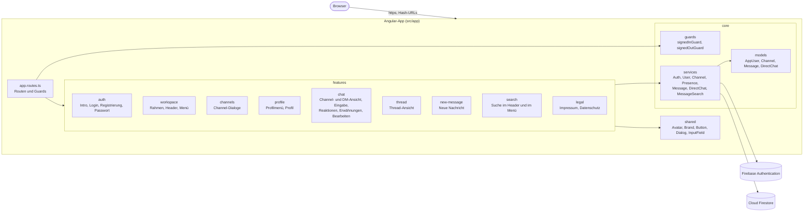
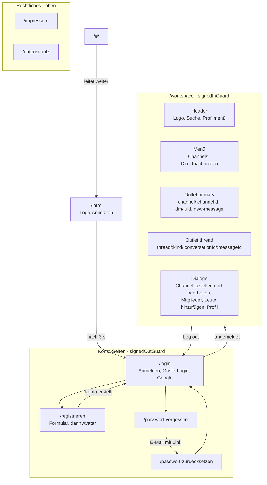
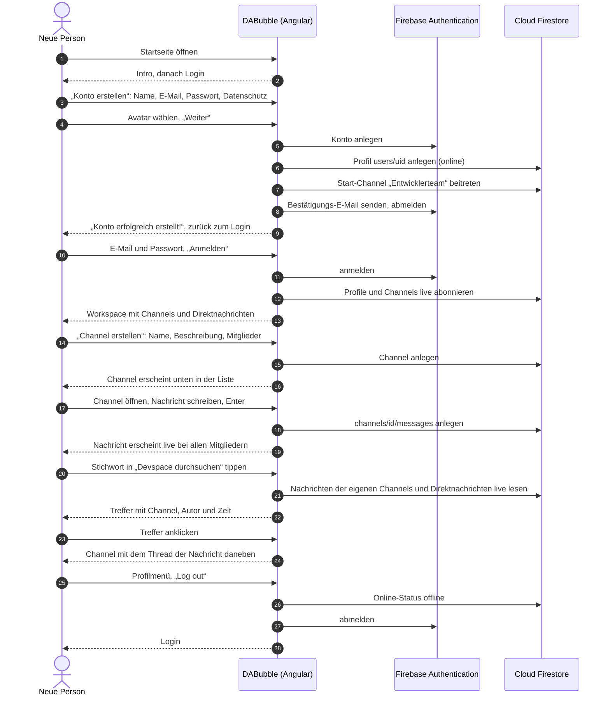
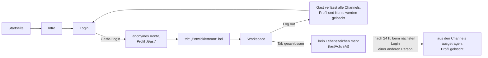
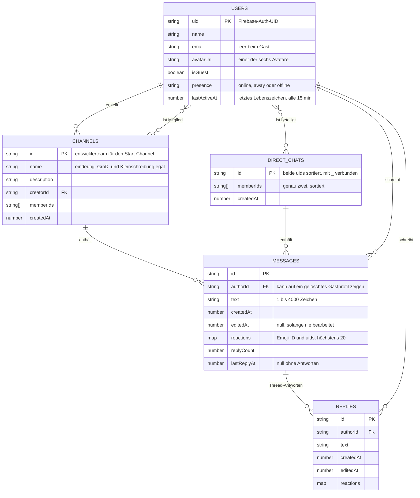
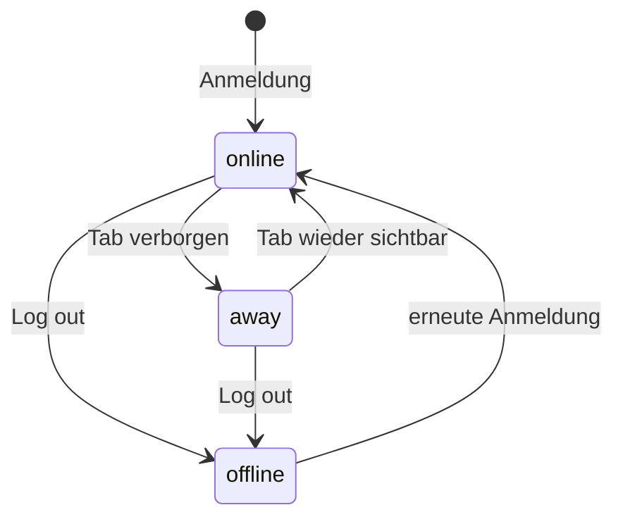
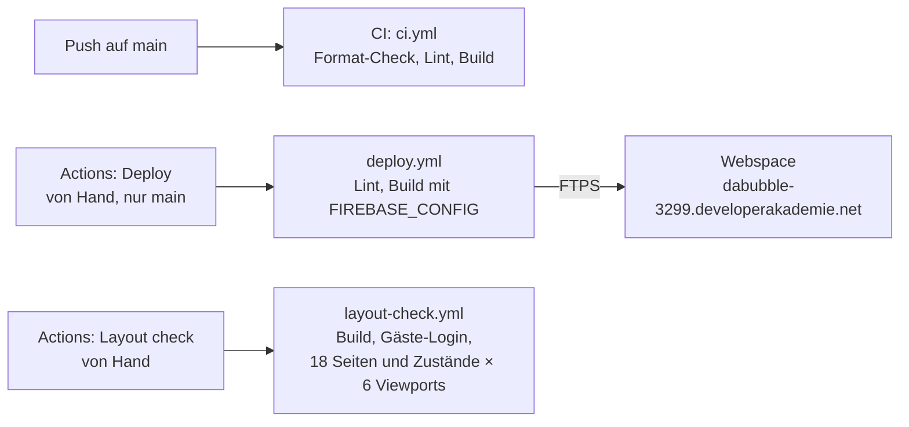

# DABubble

Team-Messenger im Stil von Slack: Channels, Direktnachrichten, Threads und Reaktionen in einem Workspace,
umgesetzt mit Angular 22 und Firebase.

[](https://github.com/ttoebbe/dabubble/actions/workflows/ci.yml)

**Live:** <https://dabubble-3299.developerakademie.net> – zum Ausprobieren „Gäste-Login“ wählen.

## Inhalt

- [Funktionen](#funktionen)
- [Tech-Stack](#tech-stack)
- [Architektur](#architektur)
- [Routen und Ansichten](#routen-und-ansichten)
- [Happy Flow](#happy-flow)
- [Datenmodell](#datenmodell)
- [Online-Status](#online-status)
- [Ordnerstruktur](#ordnerstruktur)
- [Projekt starten](#projekt-starten)
- [Qualität](#qualität)
- [CI, Deploy und Layout-Check](#ci-deploy-und-layout-check)
- [Team](#team)

## Funktionen

### Konto

- Registrierung mit Name, E-Mail, Passwort, Zustimmung zur Datenschutzerklärung und Avatar-Auswahl, danach
  Bestätigungs-E-Mail
- Anmeldung mit E-Mail und Passwort oder mit Google; Fehlermeldungen direkt am Feld
- Gäste-Login ohne Konto: Beim Log out werden Gastkonto und Profil gelöscht
- Passwort vergessen: E-Mail mit Link, danach neues Passwort setzen
- Profil ansehen und bearbeiten (Name, Avatar aus der Auswahl)
- Online-Status (aktiv, abwesend, offline) im Menü, im Profil, in Mitgliederlisten, Chats und Threads

### Workspace und Channels

- Menü mit Channels und Direktnachrichten, ein- und ausklappbar
- Channel erstellen mit Name, Beschreibung und Mitgliedern; Channel-Namen sind eindeutig
- Mitglieder hinzufügen, Channel verlassen, Name und Beschreibung bearbeiten
- Start-Channel „Entwicklerteam“, dem jedes neue Konto und jeder Gast beitritt
- Mobile Ansichten: Menü → Chat → Thread, jeweils mit Zurück-Pfeil

### Nachrichten und Suche

- Channel- und Direktnachrichten live, auch an sich selbst
- Reaktionen mit Emojis: die zwei zuletzt genutzten, „+ x weitere“, Zähler und wer reagiert hat
- Emojis im Text; eigene Nachrichten und Antworten bearbeiten
- Threads in Channels und Direktnachrichten mit „2 Antworten“ und „Letzte Antwort 14:56“
- `@` und `#` im Eingabefeld, Erwähnungen im Text klickbar
- „Neue Nachricht“: `#` listet Channels, `@` Personen, sonst Suche nach Name oder E-Mail
- Suche: `#` findet Channels, `@` Personen, sonst Nachrichten und Thread-Antworten der eigenen Channels und
  Direktnachrichten, live und mit Kontext

### Außerdem

- Intro mit Logo-Animation
- Impressum und Datenschutzerklärung

## Tech-Stack

| Bereich         | Technik                                                                                      |
| --------------- | -------------------------------------------------------------------------------------------- |
| Framework       | Angular 22: Standalone Components, Signals, zoneless, Control Flow (`@if`, `@for`)           |
| Formulare       | Signal Forms (`@angular/forms/signals`) mit eigener Validierung, keine HTML5-Meldungen       |
| Sprache         | TypeScript im Strict Mode                                                                    |
| Styles          | SCSS nach BEM, Design-Tokens als CSS Custom Properties (`src/styles/`)                       |
| Backend         | Firebase Authentication (E-Mail/Passwort, Google, anonym) und Cloud Firestore (europe-west3) |
| Routing         | Angular Router mit Hash-URLs (`/#/login`), weil der Webspace `.htaccess` nicht auswertet     |
| Code-Qualität   | ESLint (angular-eslint, Zeilenlimits, Barrierefreiheit), Prettier                            |
| Automatisierung | GitHub Actions: CI bei jedem Push, Deploy und Layout-Check von Hand                          |
| Hosting         | Webspace der Developer Akademie, Upload per FTPS                                             |

## Architektur

Die App spricht direkt mit Firebase, ein eigenes Backend gibt es nicht. Firestore-Zugriffe liegen nur in den
Services unter `core/services/`; die Komponenten lesen deren Signals.



## Routen und Ansichten

Die Routen stehen hinter `#`, z. B. `https://dabubble-3299.developerakademie.net/#/login`. Sie sind in
`auth.routes.ts`, `legal.routes.ts`, `workspace.routes.ts` und `chat.routes.ts` definiert; die Chat-Routen
hängen als Kinder unter `/workspace`. Die Konto-Seiten öffnen nur abgemeldet (`signedOutGuard`), der Workspace
nur angemeldet (`signedInGuard`), Impressum und Datenschutz immer.



Breakpoints (`src/styles/_breakpoints.scss`): ab 1440 px stehen Menü, Chat und Thread nebeneinander, ab 768 px
höchstens zwei Bereiche, darunter immer nur einer (Menü → Chat → Thread). Alle Seiten funktionieren bis 320 px
ohne horizontale Scrollleiste.

## Happy Flow

Eine neue Person registriert sich, meldet sich an, legt einen Channel an, schreibt eine Nachricht, findet sie
über die Suche wieder und meldet sich ab.



Der kürzeste Weg zum Ausprobieren ist der Gäste-Login:



Gäste, die den Tab schließen statt sich abzumelden, räumt die App selbst auf: Ein offener Tab schreibt alle
15 Minuten `lastActiveAt`; wer sich anmeldet, trägt Gäste ohne Lebenszeichen seit 24 Stunden aus den eigenen
Channels aus und löscht ihr Profil. Das leere anonyme Anmeldekonto bleibt, es taucht in der App nirgends auf.

## Datenmodell

Nachrichten liegen als Untercollection am Channel bzw. an der Direktnachricht (`channels/{id}/messages`,
`directChats/{id}/messages`), Thread-Antworten an der Nachricht (`…/messages/{id}/replies`). Eine
Direktnachricht entsteht mit der ersten Nachricht.



Die Firestore-Regeln stehen in [`firestore.rules`](firestore.rules). Kurz: Angemeldete lesen alle Profile und
Channels, jede Person schreibt nur ihr eigenes Profil, Channels ändern nur Mitglieder, und dem Start-Channel darf
man sich selbst hinzufügen. Nachrichten und Antworten lesen und schreiben nur die Mitglieder des Channels bzw.
der Direktnachricht; den Text ändert nur der Autor, reagieren dürfen alle Mitglieder (höchstens 20 Emojis je
Nachricht). Das Profil eines Gastes ohne Lebenszeichen seit 24 Stunden darf jede angemeldete Person löschen.

## Online-Status



Der Punkt am Avatar ist grün für „Aktiv“ und grau für „Abwesend“ oder offline (`PresenceService`).

## Ordnerstruktur

```text
src/
├── app/
│   ├── app.config.ts            Router (Hash-URLs), globale Fehler-Listener
│   ├── app.routes.ts            bindet die Routen der Features ein
│   ├── core/
│   │   ├── guards/              signedInGuard, signedOutGuard
│   │   ├── models/              AppUser, Channel, Message, DirectChat
│   │   └── services/            firebase, auth, user, presence, guest-cleanup, channel,
│   │                            channel-membership, message, direct-chat, message-search
│   ├── features/
│   │   ├── auth/                Intro, Login, Registrierung, Avatar, Passwort vergessen und zurücksetzen
│   │   ├── workspace/           Rahmen, Header, Menü, Menü-Umschalter
│   │   ├── channels/            Channel erstellen und bearbeiten, Mitglieder, Leute hinzufügen
│   │   ├── profile/             Profilmenü, Profil-Dialog, Profil bearbeiten, ProfileViewer
│   │   ├── chat/                Channel- und DM-Ansicht, Eingabe, Reaktionen, Erwähnungen, Bearbeiten
│   │   ├── thread/              Thread-Ansicht
│   │   ├── new-message/         „Neue Nachricht“
│   │   ├── search/              Suche im Header (Desktop) und im Menü (mobil)
│   │   └── legal/               Impressum, Datenschutz
│   └── shared/
│       └── components/          avatar, brand, button, dialog, input-field
├── environments/                environment.example.ts im Repo, environment.ts nur lokal
└── styles/                      _tokens, _base, _forms, _breakpoints
public/                          img/ (Avatare, Emojis, Icons, Logos), fonts/, .htaccess
docs/Figma/                      Design-Spec, Komponenten, Asset-Liste, Referenzbilder
firestore.rules                  Firestore-Regeln
.github/workflows/               ci.yml, deploy.yml, layout-check.yml
```

## Projekt starten

Voraussetzungen: Node.js 24, npm und ein Firebase-Projekt mit Authentication (E-Mail/Passwort, Google,
anonym) und Cloud Firestore mit den Regeln aus [`firestore.rules`](firestore.rules).

```bash
git clone https://github.com/ttoebbe/dabubble.git
```

```bash
npm install
```

Danach `src/environments/environment.example.ts` nach `src/environments/environment.ts` kopieren und die
Web-Konfiguration des Firebase-Projekts eintragen. Die Datei bleibt lokal und kommt nie ins Repo.

```bash
npm start
```

Die App läuft dann unter `http://localhost:4200/`.

| Befehl                 | Wirkung                                                                                   |
| ---------------------- | ----------------------------------------------------------------------------------------- |
| `npm start`            | Dev-Server                                                                                |
| `npm run build`        | Produktions-Build nach `dist/dabubble/browser/`                                           |
| `npm run lint`         | ESLint inkl. Zeilenlimits, Namensregeln und Barrierefreiheit                              |
| `npm run format`       | Prettier formatiert `src/`                                                                |
| `npm run format:check` | Prettier prüft `src/` (wie die CI)                                                        |
| `npm run docs`         | Code-Doku mit compodoc nach `documentation/` (gitignored); mit `-- -s` als lokaler Server |

## Qualität

- **Clean Code:** höchstens 14 Zeilen pro Funktion, 400 pro Datei, 100 pro HTML-Template, camelCase,
  sprechende Namen. ESLint prüft die Limits und Namen automatisch.
- **Formulare:** Leere, ungültige und fehlerhafte Eingaben zeigen eine konkrete Meldung direkt am Feld,
  ohne `alert()` und ohne HTML5-Standardmeldungen. Buttons haben die Zustände enabled, disabled und hover.
- **Barrierefreiheit:** axe-core meldet auf den Konto-Seiten, im Menü und in den Chat-Ansichten keine Verstöße
  gegen WCAG AA, am Desktop und mobil. Wo Figma-Farben den Kontrast von 4,5 : 1 verfehlen, sind sie abgedunkelt.
- **Design:** Werte aus der Design-Spec [`docs/Figma/spec.md`](docs/Figma/spec.md) bzw. `src/styles/`; Schrift
  mindestens 16 px (Kleingedrucktes 14 px), Touch-Targets mindestens 44 px. Abweichungen von Figma sind in der
  Spec begründet.
- **Responsiv** bis 320 px ohne horizontale Scrollleiste, ohne Layout-Shifts.
- **Konsole** ohne Fehler, auch im Inkognito-Modus.
- **Code-Doku:** JSDoc an jeder Funktion, Klasse und jedem Export; `npm run docs` erzeugt daraus mit compodoc
  eine Doku-Seite.

## CI, Deploy und Layout-Check



- **CI** läuft bei jedem Push und Pull Request.
- **Deploy** läuft nur von Hand und nur von `main`. Er baut den gewählten Commit und spiegelt ausschließlich
  `dist/dabubble/browser/` auf den Webspace. Secrets: `DEPLOY_HOST`, `DEPLOY_USER`, `DEPLOY_PASSWORD`,
  `DEPLOY_REMOTE_DIR`, `FIREBASE_CONFIG`; Variable `DEPLOY_PROTOCOL` (`ftps`).
- **Layout-Check** läuft nur von Hand: Er misst jede Seite in 320, 430, 768, 1024, 1440 und 1920 px auf
  horizontales Scrollen, Elemente außerhalb ihres Containers, Überlappungen und Randabstände. Der Checker liegt
  in einem privaten Repo; für den Workspace meldet er sich als Gast an und am Ende wieder ab. Secrets:
  `LAYOUT_CHECK_TOKEN`, `FIREBASE_CONFIG`.

## Team

Entstanden als Gruppenprojekt bei der Developer Akademie.

| Name               | GitHub                                  |
| ------------------ | --------------------------------------- |
| Thomas Többe-Hömke | [`ttoebbe`](https://github.com/ttoebbe) |
| Yannic Jundt       | [`TheYan3`](https://github.com/TheYan3) |
